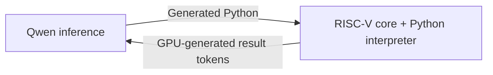

# RISCuda

### A RISC-V core inside CUDA. A whole Python program in one kernel.

**English** | [简体中文](README.zh-CN.md)

[](https://github.com/dttutty/RISCuda/actions/workflows/test.yml)

**Give your NVIDIA GPU its own RISC-V execution core.** Run real RV32IM machine
code and complete integer Python programs on the GPU: parsing, branches,
loops, memory accesses and evaluation all happen inside one CUDA kernel,
without CPU instruction stepping or host Python evaluation.

| Workload | CPU submission | Validation |
| --- | --- | --- |
| A complete RISC-V or integer Python program | **One CUDA kernel launch** | This standalone package |
| Custom tool services with yield/resume | **One CUDA kernel**, including both service calls | [Device example](examples/native_resume.cu) |
| Qwen inference → Python execution → Qwen continuation | **One host CUDA Graph launch** | [Companion integration](VALIDATION.md#llm-integration-one-host-graph-launch) |

The inference integration uses a graph containing multiple GPU kernels. Its
single host launch covers prompt prefill, generation, the Python tool and
feedback through the final answer. The standalone package provides the
RISC-V/Python execution layer and device-side service interface.

**GPU execution verified from an installed wheel · C and real MicroPython guests ·
Standalone core requires no PyTorch or model weights**

## Quick start

```bash
git clone https://github.com/dttutty/RISCuda.git
cd RISCuda
uv sync --locked
uv run gpu-rv32 python examples/sum.py --compile-only
# Select a checked idle NVIDIA GPU before execution:
CUDA_VISIBLE_DEVICES=0 uv run gpu-rv32 asm examples/multiply.S
CUDA_VISIBLE_DEVICES=0 uv run gpu-rv32 python examples/sum.py
CUDA_VISIBLE_DEVICES=0 uv run gpu-rv32 c examples/bigint.c
CUDA_VISIBLE_DEVICES=0 uv run gpu-rv32 micropython examples/bigint.py
```

```python
from gpu_rv32 import compile_program, run_program, run_assembly

print(run_assembly("li a0, 16\necall")["value"])
image = compile_program("print(2 * 8)\n")
print(run_program(image)["stdout"])
```

The current runtime targets Linux and Python 3.12+. GPU execution needs `nvcc`
(CUDA 12.x) and an Ampere-or-newer NVIDIA GPU.
The default compilation target is `sm_80`; set `GPU_RV32_CUDA_ARCH` to change it.
Native build products go to the user cache, configurable with `GPU_RV32_CACHE`.
The package includes all CUDA headers and guest C/assembly/linker sources.
The standalone runtime uses the Python standard library, the pinned Zig
toolchain and CUDA.

## What runs where

The CPU assembles raw input or builds the fixed C interpreter with Zig,
initializes guest memory, launches one CUDA kernel and collects the result.
Inside that kernel the VM fetches/decodes real RISC-V instructions and executes
all guest branches, loops, calls and memory accesses. Python parsing and
evaluation execute as guest RISC-V instructions. Host Python does not evaluate
the supplied program.

Each standalone API invocation launches one kernel. Programs and results still
cross the host/device boundary at invocation boundaries. To integrate a longer
GPU-controlled workflow, embed the device headers and use `resume_memory` as
shown below; the standalone CLI does not orchestrate an LLM.

## GPU-native tools for inference

The device core can serve as an execution engine inside a GPU-controlled
inference loop:



A companion prototype completed this cycle with real Qwen3.8-27B weights:
**117 decoding forwards, 1,338,921 guest instructions and one host graph
launch**, returning the correct answer **269859**. Nsight recorded **zero
host kernel launches and zero host/device copies during the request**.
The measured GPU graph ran for 8.225 seconds, including prompt prefill.

This is a separate model integration, with multiple kernels inside its CUDA
graph. See the [validation record](VALIDATION.md#llm-integration-one-host-graph-launch)
and [trace summary](docs/evidence/qwen_python_single_launch.json) for its scope
and provenance. The standalone one-kernel Python path is available directly
through the CLI and Python API below.

## Assembly API

```python
from gpu_rv32 import assemble, run_code, run_assembly

# CPU assembly, followed by one GPU VM invocation.
answer = run_assembly("li t0, 8\nmul a0, a0, t0\necall", input=17)
assert answer["status"] == 0 and answer["value"] == 136

# Assembly and execution both happen in the same GPU kernel.
answer = run_assembly("li a0, 16\necall", device_assembler=True)

# Direct machine code, with caller-supplied private RAM.
answer = run_code(assemble("lw a0, 0(zero)\necall"), memory=(42).to_bytes(4, "little"))
assert answer["value"] == 42
```

Raw execution accepts up to 262144 little-endian words and 1..4194304 RAM bytes.
Assembly convenience calls use fresh 1024-byte RAM, with `sp=1024` and input
in `a0`. `x0` stays zero; arithmetic wraps modulo 2^32. ECALL halts and returns
`a0`; EBREAK reports a breakpoint. Misaligned/out-of-bounds accesses fail.
Code and writable RAM are separate, so modifying RAM does not change the
instruction array.

The integer sandbox implements ADD/SUB, comparisons, shifts, bitwise logic,
integer immediates, LUI/AUIPC, branches, JAL/JALR, byte/halfword/word loads and
stores, and all eight M-extension operations:
MUL/MULH/MULHSU/MULHU/DIV/DIVU/REM/REMU. FENCE is a no-op for private RAM.
There is no privileged mode, CSR/MMU, Linux syscall ABI, floating point,
atomics, compressed instructions or full ISA compliance certification.

Both assemblers support full 32-bit `li`, ABI names or `x0`..`x31`, labels and
common pseudos (`mv`, `nop`, `j`, `call`, `ret`, zero-test/comparison branches).
Memory syntax is `offset(base)`. The CPU assembler additionally accepts AUIPC
and `jalr rd, rs1, imm`; the GPU text syntax is narrower than the VM's ISA.
They accept up to 1024 emitted instructions. The GPU assembler also limits
source to 8191 bytes and labels to 64. No assembler directives or relocations.

## C, MicroPython and native big integers

```python
from gpu_rv32 import compile_c, run_c, compile_micropython, run_micropython

c = compile_c('#include <stdio.h>\nint main(void) { printf("%d\\n", 2*8); return 0; }')
assert run_c(c)["stdout"] == "16\n"
image = compile_micropython("print(2**256)\n")
answer = run_micropython(image)
assert answer["status"] == answer["error"] == 0
print(answer["stdout"], answer["bigint_calls"])
```

`c` compiles freestanding C with Zig on the CPU before GPU execution. The entry
point is `int main(void)`; the return value is in `value`. Packaged helpers
provide memory copying, `puts`, `putchar`, `guest_write` and integer `printf`
(`%d/%i/%u/%x/%X/%s/%c/%%`, optional `l/ll/z`, width and zero padding).
There is no general libc, OS, malloc, Linux syscall or host filesystem API.

`micropython` runs **real MicroPython v1.27.0** compiled to RV32IM, with its
parser, bytecode compiler, VM, allocator and garbage collector all executing
inside the GPU kernel. Functions, classes, `for/range`, lists, dictionaries,
strings, generators, exceptions and arbitrary-precision integers are available.
The integer-only port disables floating point, native emitters, external file
imports, networking and file I/O; it is not CPython or a full desktop Python.
The pinned MIT-licensed upstream sources are packaged; see
[MicroPython provenance](src/gpu_rv32/vendor/micropython/PROVENANCE.md).
Building requires GNU make in addition to Zig, with no runtime source download.

MicroPython multiplication automatically uses a **CUDA big-integer service**
for operands up to 4096 bits each (8192-bit output). Larger products fall back
to MicroPython's exact guest implementation; addition, division, remainder
and other integer operations also execute in the guest. This is a software
coprocessor in CUDA, with no CPU callback. C can call it through
`gpu_big_mul` in `gpu_guest.h`: unsigned little-endian base-65536 limbs,
1..256 limbs per input, distinct output buffer of `an+bn` limbs. ECALL `a7=0x200`
takes output/A/A-length/B/B-length in `a0`..`a4`, and returns used output limbs
or -1 on invalid bounds/alignment/count/overlap. Result `bigint_calls` counts
service invocations. `run_code(..., services=True)` enables this ABI; unknown
services stop with VM status 7 (`unknown_service`). Guest step budgets are
cumulative across service calls. Each multiplication is separately bounded
to at most 256×256 limb products; these native operations are not RV steps.

Both new guest paths use 4 MiB RAM with at least 256 KiB reserved for stack.
MicroPython has a 1 MiB heap, 16383-byte source and 16383-byte captured stdout;
C accepts 65535-byte source and the same stdout bound. `error=1` reports an
uncaught MicroPython exception (traceback in stdout), 2 stdout overflow, 3 a
fatal guest error, and 4 an unsupported C format. `status` independently
reports machine faults/budget exhaustion. Default instruction budget is
200 million. These bounds prevent unbounded VM execution, not C memory bugs.

Every invocation is still **one host kernel launch**, including all bigint
service calls. The existing companion Qwen graph currently uses the smaller
Python subset below; this standalone backend does not automatically replace it.

## Lightweight Python subset

The guest supports signed 32-bit integers, variables, assignment, expressions,
`print(integer)`, `if/else`, `while`, `pass`, comments and spaces for indentation.
Expressions support `+ - * // %`, comparisons/chains, `& | ^ ~ << >>`,
`and/or/not`, and `True/False`. `//` and `%` use Python's floor rule; arithmetic
wraps at 32 bits. Negative shifts fail; shifts of 32 or more produce zero for
left shifts, and zero or -1 for right shifts according to the sign of the input.

This is a bounded language subset: no imports, function definitions, strings,
containers, floats, `for/range`, `break/continue`, or augmented assignment.
The limits are 4095 UTF-8 source bytes, 256 nonblank statements, 32 variables,
31-byte names, 16 nested blocks/expression levels, and 4095 stdout bytes.
Guest RAM is 64 KiB, with at least 32 KiB reserved for stack. Every source uses
the same compiled interpreter; only initial source/budget RAM changes.

`compile_program(source, statement_budget=10000)` returns the fixed ELF,
machine code, initialized RAM, symbols and build hashes. It works without CUDA.
`run_program(image, instruction_budget=20000000)` returns `value`, `stdout`,
guest `error/error_name`, VM `status/status_name`, executed `steps`, GPU kernel
time and host request time. Always check both VM status and guest error.

| VM status | Meaning |
| --- | --- |
| 0 | ECALL halt |
| 1 | Instruction budget exhausted |
| 2 | Invalid instruction fetch |
| 3 | Illegal instruction |
| 4 | Invalid/alignment-failing data access |
| 5 | EBREAK |
| 6 | Native service pending, device embedding only |

Guest errors 0..6 mean success, syntax, undefined name, division by zero,
capacity/nesting, statement budget and negative shift. GPU assembly errors
use status 6 for syntax/range and 7 for assembler capacity; their `status_name`
distinguishes these from VM execution faults.

Save artifacts with `--output runs/new_directory`; the CLI writes input source,
binary or interpreter ELF/RAM, hashes, invocation metadata and execution JSON.
GPU timings exclude compilation, allocation and input/output transfers;
request timings include allocations/transfers but exclude first library build.
This VM demonstrates execution/control flow, not faster sequential Python.

## Embed GPU-side services

`native/include/rv32_core.cuh` exposes `rv32::Machine`, `initialize`,
`execute_memory` and `resume_memory`. With `native=true`, ECALL with nonzero
`a7` yields status 6 after advancing PC; `a7=0` halts. Registers, RAM and total
instruction count survive resumption. The embedding GPU kernel services the
request, updates registers/memory and resumes the same guest.

```bash
nvcc -std=c++17 -O2 -arch=sm_80 \
  -I src/gpu_rv32/native/include examples/native_resume.cu \
  -o /tmp/native_resume
CUDA_VISIBLE_DEVICES=0 /tmp/native_resume
# {"value":86,"status":0,"steps":7,"services":2}
```

The example handles two custom service calls within one kernel, with no CPU
callbacks. Budget 4 stops at cumulative step 4, including work before the first
yield. Application-specific service handlers can embed this interface in a
CUDA execution graph. Matrix, filesystem and model orchestration remain
application-level integrations.

## Tests and packaging

```bash
uv sync --locked
uv run python -m unittest discover -s tests -v  # CPU; GPU cases skip
# After checking GPU occupancy and health:
CUDA_VISIBLE_DEVICES=0 GPU_RV32_TESTS=1 \
  uv run python -m unittest discover -s tests -v
uv build
```

CI runs CPU assembly/build/resource checks without a GPU. The opt-in GPU suite
covers arithmetic/division edge cases, branches/calls, memory traps, CPU/GPU
assembler parity, Python control flow/errors/limits and native yield/resume.
See [VALIDATION.md](VALIDATION.md) for the recorded standalone validation and
[PROVENANCE.json](PROVENANCE.json) for extraction origins and source hashes.

## Citation

If you use RISCuda in your work, please cite:

```bibtex
@software{zhao2026riscuda,
  author  = {Zhao, Lei and Lee, Chul-Ho},
  title   = {{RISCuda}: a {RISC-V} core and {Python} interpreter on {CUDA}},
  year    = {2026},
  version = {0.1.0},
  url     = {https://github.com/dttutty/RISCuda}
}
```

The citation is also available as [BibTeX](CITATION.bib) and
[Citation File Format](CITATION.cff) for GitHub's **Cite this repository** feature.
