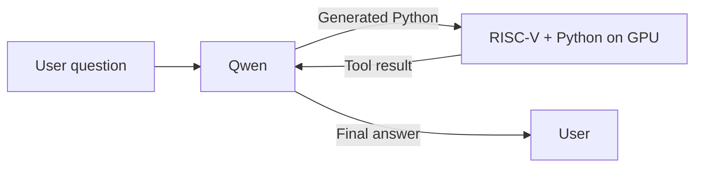

# RISCuda

### A RISC-V core inside CUDA. A whole Python program in one kernel.

**English** | [简体中文](README.zh-CN.md)

[](https://github.com/dttutty/RISCuda/actions/workflows/test.yml)

**Give your NVIDIA GPU its own RISC-V execution core.** RISCuda runs real RV32IM machine code inside CUDA, bringing C and Python programs onto the GPU.

- **A whole program in one kernel:** parsing, branches, loops and evaluation stay on the GPU.
- **Real MicroPython:** functions, containers, exceptions and arbitrary-size integers.
- **GPU-side tools:** embed execution in a GPU-controlled Qwen inference loop.

## Ask Qwen. Run Python on the GPU.

This example comes from a recorded Qwen3.8-27B run with our lightweight Python interpreter.

**1. Ask Qwen a question:**

> Use a Python while loop to calculate a total, starting at zero. For each integer i from 1 through 137, add i² if i is divisible by 3; otherwise subtract 2i. Output the final total.

**2. Qwen generates Python for its tool call:**

```python
i = 1
total = 0
while i <= 137:
    if i % 3 == 0:
        total = total + i * i
    else:
        total = total - 2 * i
    i = i + 1
print(total)
```

**3. RISCuda's GPU RISC-V core executes the Python interpreter** and feeds the result, `269859`, back to Qwen.

**4. Qwen uses the tool result to answer the user:** the total is **269859**.

The recorded loop runs under **one host CUDA Graph launch**, with generation, Python execution and feedback controlled on the GPU. This Python integration is a companion prototype; the controller shipped here uses a fixed C calculator. See the [recorded prompt, generated code and result](docs/evidence/qwen_python_single_launch.json) and [validation scope](docs/results/qwen-python.md). To run standalone Python programs, start with the [quick start](docs/quickstart.md).

## How execution works



The CPU prepares and submits the request, then collects the final answer. A CUDA Graph contains multiple kernels; a standalone Python invocation executes in **one CUDA kernel**. The standalone MicroPython port supports integer computation. See [execution architecture](docs/architecture.md) and the [Qwen/C integration](docs/autonomous-calc.md).

## Measured result

On 200 paired arithmetic problems, both arms scored **195/200**. Across the 194 requests both completed correctly, RISCuda reduced total end-to-end latency by **15.9%**. Both arms used CPU decoding loops; this comparison measures the execution-engine substitution. See [results, method and limitations](docs/results/qwenputer-arithmetic.md).

## Documentation

| I want to… | Read |
| --- | --- |
| Install and run an example | [Quick start](docs/quickstart.md) |
| Run Python | [MicroPython](docs/micropython.md) |
| Run C | [C guide](docs/c.md) |
| Execute assembly or machine code | [RV32 reference](docs/rv32.md) |
| Use the lightweight interpreter | [Python subset](docs/python-subset.md) |
| Embed CUDA or extend services | [Device API](docs/device-api.md) |
| Integrate Qwen | [Autonomous inference](docs/autonomous-calc.md) |
| Reproduce the comparison | [Benchmark guide](benchmarks/README.md) |
| Inspect evidence | [Validation index](VALIDATION.md) |
| Develop and test | [Development guide](docs/development.md) |

## Citation

If you use RISCuda in your work, please cite:

```bibtex
@software{zhao2026riscuda,
  author  = {Zhao, Lei and Lee, Chul-Ho},
  title   = {{RISCuda}: a {RISC-V} core and {Python} interpreter on {CUDA}},
  year    = {2026},
  version = {0.1.0},
  url     = {https://github.com/dttutty/RISCuda}
}
```

The citation is also available as [BibTeX](CITATION.bib) and
[Citation File Format](CITATION.cff) for GitHub's **Cite this repository** feature.
