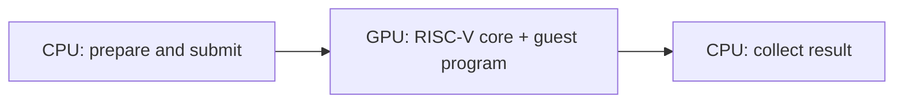

# RISCuda

### A RISC-V core inside CUDA. A whole Python program in one kernel.

**English** | [简体中文](README.zh-CN.md)

[](https://github.com/dttutty/RISCuda/actions/workflows/test.yml)

**Give your NVIDIA GPU its own RISC-V execution core.** RISCuda runs real RV32IM machine code inside CUDA, bringing C and Python programs onto the GPU.

- **A whole program in one kernel:** parsing, branches, loops and evaluation stay on the GPU.
- **Real MicroPython:** functions, containers, exceptions and arbitrary-size integers.
- **GPU-side tools:** embed execution in a GPU-controlled Qwen inference loop.

## Try it

Requires Linux, Python 3.12+, CUDA 12.x `nvcc`, GNU make and an NVIDIA Ampere-or-newer GPU.

```bash
git clone https://github.com/dttutty/RISCuda.git
cd RISCuda
uv sync --locked
```

With an available GPU selected, run using `uv run python`:

```python
from gpu_rv32 import compile_micropython, run_micropython

image = compile_micropython("print(sum(i * i for i in range(1, 11)))\n")
answer = run_micropython(image)
assert answer["status"] == answer["error"] == 0
print(answer["stdout"], end="")  # 385
```

Output: `385`. See [quick start](docs/quickstart.md) for configuration and CLI usage.

## How execution works



Standalone programs execute in **one CUDA kernel**; the CPU prepares inputs, submits work and collects results. The autonomous Qwen tool loop uses **one host CUDA Graph launch**, containing multiple kernels. MicroPython is an integer-only port; the current Qwen controller calls a fixed C calculator. See [execution architecture](docs/architecture.md) and [inference integration](docs/autonomous-calc.md).

## Measured result

On 200 paired arithmetic problems, both arms scored **195/200**. Across the 194 requests both completed correctly, RISCuda reduced total end-to-end latency by **15.9%**. Both arms used CPU decoding loops; this comparison measures the execution-engine substitution. See [results, method and limitations](docs/results/qwenputer-arithmetic.md).

## Documentation

| I want to… | Read |
| --- | --- |
| Install and run an example | [Quick start](docs/quickstart.md) |
| Run Python | [MicroPython](docs/micropython.md) |
| Run C | [C guide](docs/c.md) |
| Execute assembly or machine code | [RV32 reference](docs/rv32.md) |
| Use the lightweight interpreter | [Python subset](docs/python-subset.md) |
| Embed CUDA or extend services | [Device API](docs/device-api.md) |
| Integrate Qwen | [Autonomous inference](docs/autonomous-calc.md) |
| Reproduce the comparison | [Benchmark guide](benchmarks/README.md) |
| Inspect evidence | [Validation index](VALIDATION.md) |
| Develop and test | [Development guide](docs/development.md) |

## Citation

If you use RISCuda in your work, please cite:

```bibtex
@software{zhao2026riscuda,
  author  = {Zhao, Lei and Lee, Chul-Ho},
  title   = {{RISCuda}: a {RISC-V} core and {Python} interpreter on {CUDA}},
  year    = {2026},
  version = {0.1.0},
  url     = {https://github.com/dttutty/RISCuda}
}
```

The citation is also available as [BibTeX](CITATION.bib) and
[Citation File Format](CITATION.cff) for GitHub's **Cite this repository** feature.
