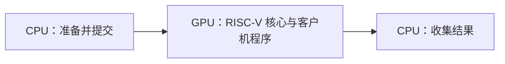

# RISCuda

### RISC-V 核心搬进 CUDA。完整 Python 程序，一个 kernel 执行。

[English](README.md) | **简体中文**

[](https://github.com/dttutty/RISCuda/actions/workflows/test.yml)

**给 NVIDIA GPU 一个自己的 RISC-V 执行核心。** RISCuda 在 CUDA 中运行真实的 RV32IM 机器码，让 C 和 Python 程序在 GPU 上执行。

- **完整程序，一个 kernel：** 解析、分支、循环和求值在 GPU 内完成。
- **真正的 MicroPython：** 支持函数、容器、异常和任意精度整数。
- **GPU 内工具调用：** 可嵌入 Qwen 的 GPU 自主推理循环。

## 试一下

需要 Linux、Python 3.12+、CUDA 12.x 的 `nvcc`、GNU make 和 NVIDIA Ampere 或更新架构 GPU。

```bash
git clone https://github.com/dttutty/RISCuda.git
cd RISCuda
uv sync --locked
```

选择空闲 GPU 后，通过 `uv run python` 运行：

```python
from gpu_rv32 import compile_micropython, run_micropython

image = compile_micropython("print(sum(i * i for i in range(1, 11)))\n")
answer = run_micropython(image)
assert answer["status"] == answer["error"] == 0
print(answer["stdout"], end="")  # 385
```

输出为 `385`。安装配置和命令行用法见[快速开始](docs/quickstart.zh-CN.md)。

## 怎样执行



独立程序在**一个 CUDA kernel** 内执行，CPU 负责准备、提交和最终取回结果。Qwen 自主工具循环使用**一次主机 CUDA Graph 启动**，图内包含多个 kernel。当前 MicroPython 为整数版本；当前 Qwen 控制器调用固定 C 计算器。详见[执行架构](docs/architecture.zh-CN.md)与[推理集成](docs/autonomous-calc.zh-CN.md)。

## 实验结果

在 200 道配对算术题上，两组均答对 **195/200**；双方正确且正常结束的 194 个请求中，RISCuda 端到端总耗时降低 **15.9%**。该对比的两组都使用 CPU 解码循环，衡量执行引擎替换的效果。见[结果、方法与限制](docs/results/qwenputer-arithmetic.zh-CN.md)。

## 文档

| 我想…… | 阅读 |
| --- | --- |
| 安装并运行例子 | [快速开始](docs/quickstart.zh-CN.md) |
| 运行 Python | [MicroPython](docs/micropython.zh-CN.md) |
| 运行 C | [C 指南](docs/c.zh-CN.md) |
| 执行汇编或机器码 | [RV32 参考](docs/rv32.zh-CN.md) |
| 使用轻量整数解释器 | [Python 子集](docs/python-subset.zh-CN.md) |
| 嵌入 CUDA 或扩展服务 | [设备 API](docs/device-api.zh-CN.md) |
| 接入 Qwen | [自主推理](docs/autonomous-calc.zh-CN.md) |
| 复现性能对比 | [评测指南](benchmarks/README.zh-CN.md) |
| 查看验证证据 | [验证索引](VALIDATION.zh-CN.md) |
| 开发与测试 | [开发指南](docs/development.zh-CN.md) |

## 引用

如果你在工作中使用了 RISCuda，请引用：

```bibtex
@software{zhao2026riscuda,
  author  = {Zhao, Lei and Lee, Chul-Ho},
  title   = {{RISCuda}: a {RISC-V} core and {Python} interpreter on {CUDA}},
  year    = {2026},
  version = {0.1.0},
  url     = {https://github.com/dttutty/RISCuda}
}
```

引用信息也提供 [BibTeX](CITATION.bib) 和
[Citation File Format](CITATION.cff) 格式，可用于 GitHub 的 **Cite this repository** 功能。
