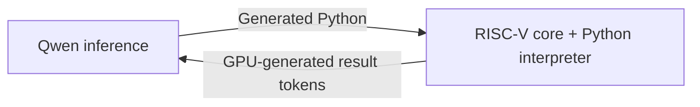

# CPU, GPU and inference execution

**English** | [简体中文](architecture.zh-CN.md) · [Home](../README.md)

| Workload | CPU submission | Validation |
| --- | --- | --- |
| A complete RISC-V or integer Python program | **One CUDA kernel launch** | This standalone package |
| Custom tool services with yield/resume | **One CUDA kernel**, including both service calls | [Device example](../examples/native_resume.cu) |
| Qwen → native C calculator → Qwen | **One host CUDA Graph launch**, including prefill | [GPU controller](../docs/autonomous-calc.md) |
| Qwen inference → Python execution → Qwen continuation | **One host CUDA Graph launch** | [Companion integration](../VALIDATION.md#llm-integration-one-host-graph-launch) |

The CPU assembles raw input or builds the fixed C interpreter with Zig,
initializes guest memory, launches one CUDA kernel and collects the result.
Inside that kernel the VM fetches/decodes real RISC-V instructions and executes
all guest branches, loops, calls and memory accesses. Python parsing and
evaluation execute as guest RISC-V instructions. Host Python does not evaluate
the supplied program.

Each standalone API invocation launches one kernel. Programs and results still
cross the host/device boundary at invocation boundaries. To integrate a longer
GPU-controlled workflow, embed the device headers and use `resume_memory` via the [device API](device-api.md); the standalone CLI does not orchestrate an LLM.

## Earlier companion Qwen/Python prototype

The device core can serve as an execution engine inside a GPU-controlled
inference loop:

A companion prototype completed this cycle with real Qwen3.8-27B weights:
**117 decoding forwards, 1,338,921 guest instructions and one host graph
launch**, returning the correct answer **269859**. Nsight recorded **zero
host kernel launches and zero host/device copies during the request**.
The measured GPU graph ran for 8.225 seconds, including prompt prefill.

This is a separate model integration, with multiple kernels inside its CUDA
graph. See the [validation record](../VALIDATION.md#llm-integration-one-host-graph-launch)
and [trace summary](../docs/evidence/qwen_python_single_launch.json) for its scope
and provenance. The standalone one-kernel Python path is available directly
through the lightweight Python guide.

[Lightweight Python guide](python-subset.md).
