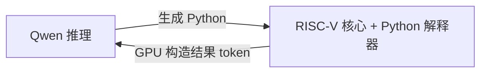

# CPU、GPU 与推理循环

[English](architecture.md) | **简体中文** · [返回首页](../README.zh-CN.md)

| 工作负载 | CPU 提交方式 | 验证范围 |
| --- | --- | --- |
| 一段完整的 RISC-V 或整数 Python 程序 | **一次 CUDA kernel 调用** | 当前独立库 |
| 包含暂停/恢复的自定义工具服务 | **一个 CUDA kernel**，包含两次服务调用 | [设备端示例](../examples/native_resume.cu) |
| Qwen → 原生 C 计算器 → Qwen | **一次主机 CUDA Graph 启动**，包含预填充 | [GPU 控制器](../docs/autonomous-calc.zh-CN.md) |
| Qwen 推理 → Python 执行 → Qwen 继续推理 | **一次主机 CUDA Graph 启动** | [配套推理原型](../VALIDATION.zh-CN.md#llm-集成一次主机执行图启动) |

CPU 负责汇编输入，或使用 Zig 构建固定的 C 解释器，
随后初始化客户机内存、启动一次 CUDA kernel，并收集结果。
在该 kernel 内，虚拟机读取并解码真实的 RISC-V 指令，执行客户机程序的
全部分支、循环、函数调用和内存访问。Python 源码的解析与求值也通过
客户机 RISC-V 指令执行，宿主机 Python 不会直接求值输入程序。

每次调用独立 API 都会启动一个 kernel，程序和结果仍会在调用边界处
进行主机与设备之间的传输。如果需要接入由 GPU 控制的更长工作流，
可以嵌入设备端头文件并使用[设备 API](device-api.zh-CN.md) 的 `resume_memory` 接口。
独立命令行工具本身不负责 LLM 编排。

## 较早的 Qwen/Python 配套原型

设备端核心可以作为执行引擎，嵌入由 GPU 控制的推理循环：

配套原型已使用真实 Qwen3.8-27B 权重跑通该循环：
**117 次解码前向、1,338,921 条客户机指令，仅需一次主机执行图启动**，
得到正确答案 **269859**。Nsight 记录显示，**请求期间主机 kernel 启动为零，
主机与设备之间的数据拷贝也为零**。GPU 执行图耗时 8.225 秒，包含提示词预填充。

这是单独的模型集成，其 CUDA 执行图内部包含多个 kernel。
验证范围和来源见[验证记录](../VALIDATION.zh-CN.md#llm-集成一次主机执行图启动)
与[轨迹摘要](../docs/evidence/qwen_python_single_launch.json)。
独立库的单 kernel Python 执行路径，可以通过轻量 Python 指南直接使用。

[轻量 Python 指南](python-subset.zh-CN.md)。
